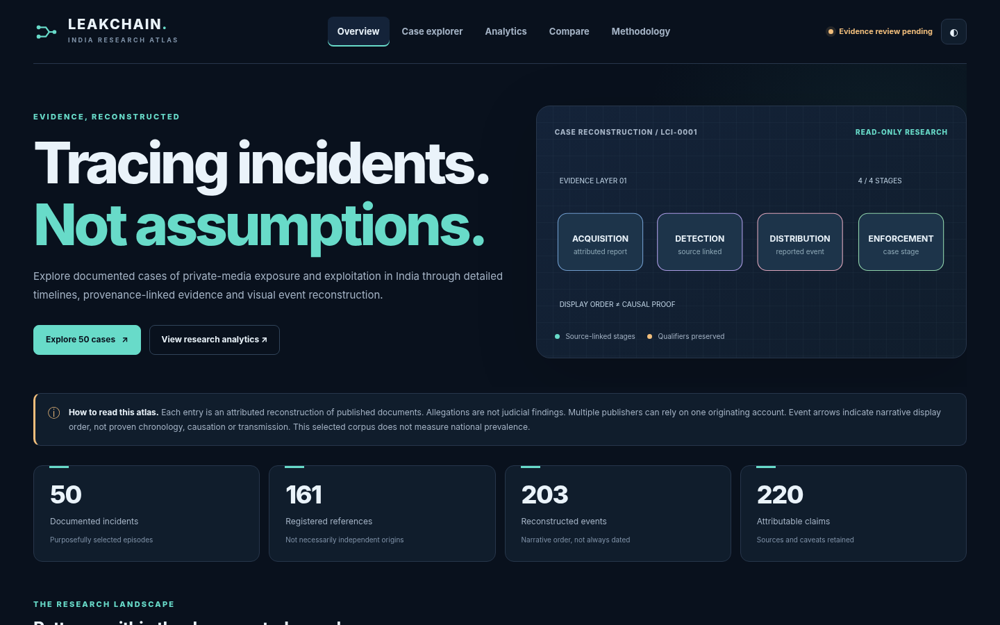

# LeakChain India

### An evidence-linked incident reconstruction atlas

**Interactive research website and reproducible dataset · version 0.9.2 · 26 October 2026**

LeakChain India is a read-only research atlas of **50 screened incident episodes** documented in India. It offers interactive event-level timelines, search and filters, case comparisons, exploratory analytics, and source-level evidence annotations. The research corpus contains **161 registered documents**, **203 reconstructed events**, and **220 evidence claims**.

> **Interpretation:** This is a purposive, source-attributed document corpus. Allegations are not judicial findings; separate publishers can cite the same originating report; timeline stages follow coded narrative order, rather than necessarily establishing actual chronology or transmission. It is not an estimate of national crime prevalence. Independent fact-level corroboration and second-coder review are not certified for the complete corpus.



## Run the website

**No installation, account, Node.js build, framework download, server, or API key is required.**

1. Download and extract the repository ZIP.
2. Open **`index.html`** in your browser. Data is already embedded in `assets/data.js`, so the site works offline.
3. Explore incidents, timeline stages, linked evidence, statistics and comparisons.

Optionally, run `python -m http.server 8000` from the repository root and open `http://localhost:8000` to test the site under a conventional local web server.

### Publish with GitHub Pages

1. Create a GitHub repository, such as `leakchain-india`.
2. Upload **the contents of this extracted `leakchain-india` directory to the repository root**. Do not upload the ZIP itself as the only file, and do not leave all files inside an extra nested directory.
3. In GitHub, open **Settings → Pages → Build and deployment**.
4. Set **Source: Deploy from a branch**, branch **`main`**, folder **`/(root)`**, and save.
5. When GitHub Pages deploys, the research website will be accessible at `https://YOUR_USERNAME.github.io/leakchain-india/` for a project repository.

All navigation uses URL fragments, e.g. `#/case/LCI-0001`, so case links work on GitHub Pages without server routing rules. The site contains no third-party trackers, APIs or embedded incident imagery.

### What the interface includes

| Section | Features |
|---|---|
| **Overview** | Hero reconstruction illustration, corpus metrics, incident mechanisms, circulation composition, featured cases |
| **Case explorer** | Full-text search, state/category/scope/stage/exception filters, sorting, pagination, filtered JSON/CSV export |
| **Incident detail** | Interactive event timeline, selectable stages, selected-event evidence, court-status distinctions, linked sources, documented exceptions |
| **Analytics** | Incident categories, states/territories, event types, reporting scope, source composition, date completeness, and review status |
| **Compare** | Side-by-side case comparison, up to four records, aligned by mechanisms, sources, event types and limitations |
| **Methodology** | Evidence standards, provenance rules, judicial nuance, source independence, supporting documentation |

The interactive timeline explicitly labels **uncertain/unknown event dates**. Claim cards show their source, locator, evidence class, adjudication scope where applicable, and interpretative limit. **No incident photographs or private recordings are served by this repository.**

## Dataset structure

```text
index.html                    GitHub Pages homepage
assets/
  app.js                      Read-only interface and visualizations
  styles.css                  Responsive dark/light design
  data.js                     Generated offline copy of the audited browser dataset
  favicon.svg                 Original project mark
ui_data/                     Regenerated research JSON exports
data/                        Original audited CSV tables and frozen historical versions
src/                         Validation, data export, reconstruction, site-bundle and manifest tools
tests/                       Research and website integrity tests
docs/                        Research protocol, coding manual, quality-cycle report and checkpoints
outputs/                     Regenerated case reconstructions and research graph descriptions
manifest.json                 Checksums for tracked repository files
LICENSE                       Existing project license
```

**Important:** Original v0.9 data tables are unchanged by the interface work. `assets/data.js` is a derived display artifact, never an independent dataset. The source CSV tables remain authoritative.

## Reproducibility and quality checks

Requires only Python 3.9+ and the Python standard library:

```bash
python src/validate.py
python src/reconstruct.py
python src/build_site_data.py
python -m unittest discover -s tests -v
python src/verify_manifest.py
```

If the CSVs change, regenerate `ui_data` and `assets/data.js` with `python src/build_site_data.py`. Regenerating tracked files also requires refreshing manifest hashes using `python src/build_manifest.py` before running the manifest verifier. The manifest script excludes its own output and bytecode caches.

Detailed research limits are documented in [`docs/quality_cycle_v0_9.md`](docs/quality_cycle_v0_9.md), the [`coding manual`](docs/coding_manual.md), and the [`research protocol`](docs/research_protocol.md). The current UI release notes are at [`docs/interface_release_v0_9_2.md`](docs/interface_release_v0_9_2.md); the previous version is preserved in [`v0.9.1`](docs/interface_release_v0_9_1.md).

## Privacy, ethics and scope

The interface presents non-identifying research summaries, publicly linked media reports, court-document references where obtained, and researcher-coded event records. It intentionally avoids victim identities, intimate content, suspect-account handles, and private-media previews. News articles and official documents remain attributed to their respective publishers and institutions.

Research status: **documentation threshold met; independent source-lineage certification and external second-coder validation remain pending.** This is a complete working interface, not a claim that all underlying alleged events have been independently established.
